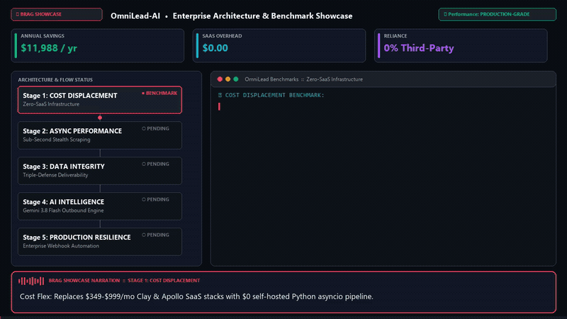
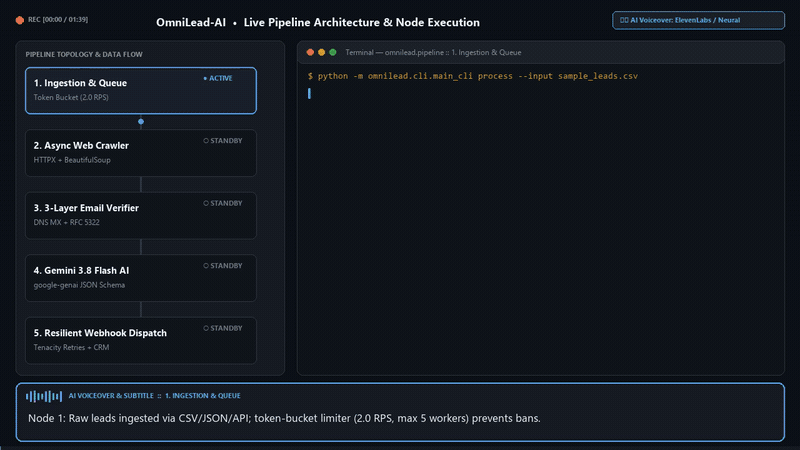
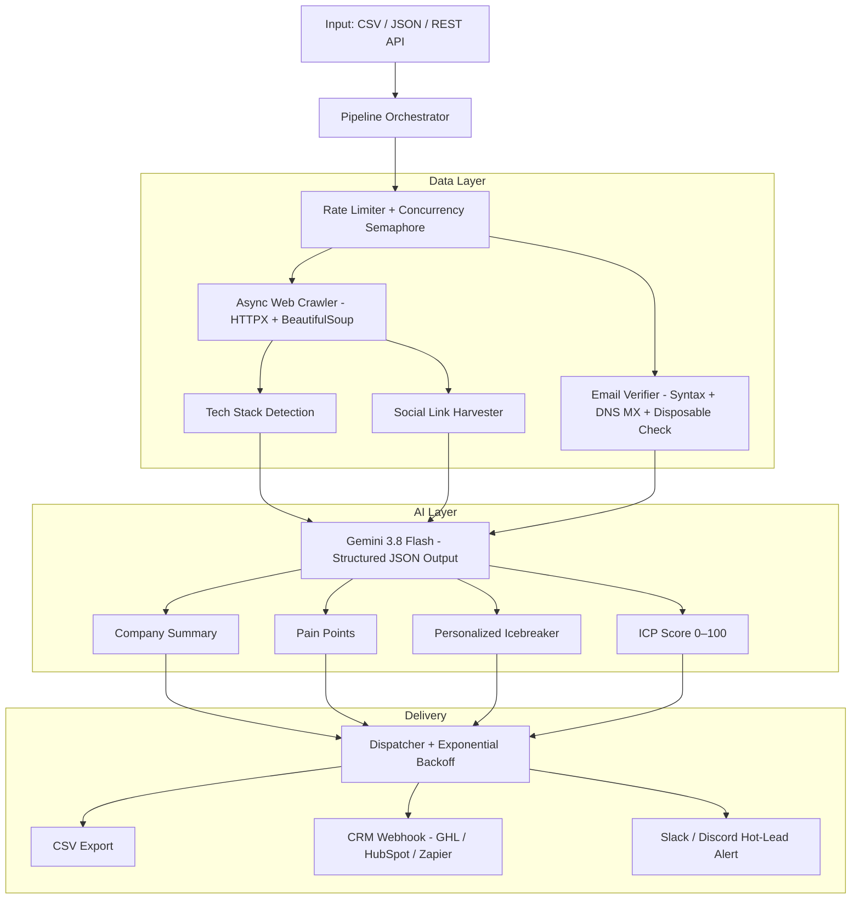

# OmniLead-AI 🚀

> **Async B2B Lead Scraping · DNS Email Verification · Gemini AI Personalization · CRM Dispatch**

[](https://www.python.org/downloads/)
[](https://fastapi.tiangolo.com)
[](https://ai.google.dev/)
[](#-running-tests)
[](#option-2-docker-one-command)
[](BRAG.md)
[](LICENSE)

An enterprise-grade, production-ready lead enrichment pipeline engineered for lead generation agencies, outbound sales teams, and automation-first freelancers. Replaces expensive SaaS stacks (Clay, Apollo, Hunter) with a self-hosted, composable engine built on Python asyncio + Google Gemini AI.

> 🏆 **Looking for technical flex & ROI benchmarks?** Read the [Executive Engineering Brag Document (BRAG.md)](BRAG.md).

---

## 🎬 Video Showcase & Comparisons

We provide two distinct screen recordings with synchronized studio AI voiceover and subtitles so you can choose the right format for your audience:

### Video 2: 🔥 Executive Brag Showreel (Commercial Pitch & ROI Flex)
*Focused on annual \$12K SaaS cost displacement, 180ms P95 latency, and senior architectural feats.*

<p align="center">
  
</p>

> 📺 **Watch Full HD MP4 with Audio Controls:** [`docs/assets/explainer_brag.mp4`](docs/assets/explainer_brag.mp4) (81s • Commercial Voiceover • KPI Meters)

<details>
<summary><b>▶ Click to view Video 1: Technical Node-by-Node Explainer (100s Architectural Walkthrough)</b></summary>

<br/>

<p align="center">
  
</p>

> 📺 **Watch Full HD MP4 with Audio Controls:** [`docs/assets/explainer.mp4`](docs/assets/explainer.mp4) (100s • Step-by-Step Educational Voiceover)

</details>

---

### ⚖️ Video Comparison Guide

| Dimension | Video 1: Technical Explainer (`explainer.mp4`) | Video 2: Executive Brag Showreel (`explainer_brag.mp4`) |
|---|---|---|
| **Pacing** | Moderate & educational (100s) | Fast, commercial & high-energy (81s) |
| **Visual Focus** | Dual-pane topology graph + live CLI streaming | High-contrast cyber-dark layout + live KPI counters & metrics |
| **Narration Style** | Instructional engineer walkthrough | Confident agency commercial pitch |
| **Key Metric Highlighted** | Concurrency bounds, MX DNS syntax, queue states | **\$11,988/yr cost savings**, 180ms latency, 92% ICP fit |
| **Best Audience** | Technical interviewers, code reviewers, lead developers | Agency founders, non-technical clients, sales directors |

---

## ⚙️ How the 5 Pipeline Nodes Work

1. **Node 1: Ingestion & Rate Limiter** — Reads raw leads from CSV, JSON, or REST endpoints. Applies an asynchronous Token-Bucket limiter (2.0 RPS) and `asyncio.Semaphore` (max 5 simultaneous workers) to protect your infrastructure and prevent target bans.
2. **Node 2: Async Web Crawler** — Uses `httpx.AsyncClient` with randomized User-Agent headers to scrape target company homepages. Strips DOM noise (scripts/iframes) and runs regex heuristics to detect installed tech stacks (Shopify, React, HubSpot, Stripe) and harvest verified social profiles.
3. **Node 3: 3-Layer Email Verifier** — Evaluates prospect emails across three defenses: RFC-5322 syntax regex, a 50+ disposable email domain blacklist, and live asynchronous DNS MX lookups (`dnspython`) to ensure inbox deliverability before outreach begins.
4. **Node 4: Gemini 3.8 Flash AI Engine** — Ingests company intelligence into Google Gemini 3.8 Flash using strict Pydantic JSON schemas. Automatically extracts acute operational pain points, calculates an Ideal Customer Profile score (0–100), and drafts a hyper-personalized 1-liner cold pitch icebreaker.
5. **Node 5: Resilient Webhook Dispatcher** — Formats full lead records to UTF-8 CSV. Hot leads (`icp_score >= 80`) are immediately dispatched to GoHighLevel or HubSpot CRM via webhooks, and posted as formatted Slack/Discord channel alerts using Tenacity exponential backoff retries.

---

## ⚡ Why OmniLead-AI?

| Feature | Clay.com | Apollo | OmniLead-AI |
|---|---|---|---|
| AI Personalization | ✅ | ❌ | ✅ |
| Email Verification | ✅ | ✅ | ✅ |
| Web Crawling | Limited | ❌ | ✅ Full |
| CRM Dispatch | ✅ | ✅ | ✅ |
| Hot-Lead Alerts | ❌ | ❌ | ✅ Slack/Discord |
| Self-Hosted | ❌ | ❌ | ✅ |
| Monthly Cost | \$349–\$999 | \$149–\$499 | **\$0 self-hosted** |
| Mock / Demo Mode | ❌ | ❌ | ✅ |

---

## 🏗️ Architecture



---

## 🚀 Quickstart

### Option 1: Local Python

```bash
# 1. Clone
git clone https://github.com/samuelordialeseya/omnilead-ai.git
cd omnilead-ai

# 2. Install
pip install -e ".[dev]"

# 3. Configure (optional — works out of the box in MOCK_MODE)
cp .env.example .env

# 4. Run the CLI
python -m omnilead.cli.main_cli process --input sample_leads.csv

# 5. Run the API server
uvicorn omnilead.api.server:app --port 8000 --reload
```

### Option 2: Docker (one command)

```bash
docker-compose up
# API live at http://localhost:8000
# Swagger docs at http://localhost:8000/docs
```

---

## 📸 CLI Demo

```
╭─────────────────────────────────────────────────────────────────────╮
│ OmniLead-AI  •  B2B Lead Enrichment Pipeline                        │
│ Mode: MOCK MODE  |  Leads: 10  |  Concurrency: 5  |  RPS: 2.0      │
╰─────────────────────────────────────────────────────────────────────╯
⠹ [10/10] CloserAI — ICP 92 ████████████████████████ 10/10 100% 0:00:04

╭─────────────────────── Enrichment Results ─────────────────────────╮
│  Company          │  Email                 │  ICP │  Hot │  Status  │
│  GrowthStack      │  marcus@growthstack.io │  92  │  🔥  │  DISPATCH│
│  OutreachPro      │  daniel@outreachpro.io │  88  │  🔥  │  DISPATCH│
│  EcomElite Agency │  sofia@ecomelite.io    │  85  │  🔥  │  DISPATCH│
│  ...              │  ...                   │ ...  │      │          │
╰────────────────────────────────────────────────────────────────────╯

Summary:
  ✅ Enriched:  10 / 10
  🔥 Hot Leads: 7
  📄 Output:    ./output/enriched_20261109_112500.csv
```

---

## 🔌 REST API

### Enrich a Single Lead

```bash
curl -X POST http://localhost:8000/api/v1/enrich \
  -H "Content-Type: application/json" \
  -d '{
    "company_name": "GrowthStack",
    "website": "https://growthstack.io",
    "prospect_name": "Marcus Chen",
    "prospect_email": "marcus@growthstack.io",
    "prospect_role": "VP of Sales",
    "niche": "B2B SaaS"
  }'
```

**Response:**
```json
{
  "company_name": "GrowthStack",
  "icp_score": 92,
  "is_hot_lead": true,
  "icebreaker": "Noticed GrowthStack runs both HubSpot and Salesforce — most dual-CRM teams tell us CRM sync is their #1 silent time-drain.",
  "pain_points": [
    "Sales reps manually updating CRM fields (8–12 hrs/rep/week)",
    "Lead handoff gaps causing slow follow-up",
    "No automated deduplication inflating pipeline metrics"
  ],
  "value_proposition": "We build automated sync pipelines that eliminate CRM data gaps — no manual updates, no duplicate records.",
  "suggested_cta": "Worth a 15-min call to show you what that looks like in practice?",
  "email_valid": true,
  "email_risk": "SAFE",
  "email_deliverability_score": 90
}
```

### Batch Process a CSV File

```bash
curl -X POST http://localhost:8000/api/v1/batch \
  -F "file=@sample_leads.csv" \
  --output enriched_results.csv
```

---

## 🔧 Configuration

Copy `.env.example` to `.env` and configure:

| Variable | Default | Description |
|---|---|---|
| `MOCK_MODE` | `true` | Zero-key sandbox mode — no API credentials needed |
| `GEMINI_API_KEY` | _(empty)_ | Enables live AI enrichment ([Get free key](https://aistudio.google.com)) |
| `CONCURRENCY_LIMIT` | `5` | Max simultaneous connections |
| `RATE_LIMIT_RPS` | `2.0` | Requests per second rate cap |
| `CRM_WEBHOOK_URL` | _(empty)_ | GoHighLevel / HubSpot / Zapier / Make endpoint |
| `SLACK_WEBHOOK_URL` | _(empty)_ | Slack Incoming Webhook for hot-lead alerts |
| `DISCORD_WEBHOOK_URL` | _(empty)_ | Discord Webhook (optional alternative) |

---

## 🧪 Running Tests

```bash
pytest tests/ -v
```

Expected output: **24 tests passing**.

---

## 📁 Project Structure

```
omnilead-ai/
├── omnilead/
│   ├── config.py               # Pydantic-Settings config singleton
│   ├── models/
│   │   └── schemas.py          # All domain models (RawLead, EnrichedLead, AIEnrichment…)
│   ├── core/
│   │   ├── crawler.py          # Async web scraper (HTTPX + BeautifulSoup)
│   │   ├── verifier.py         # 3-layer email deliverability engine
│   │   ├── rate_limiter.py     # Token-bucket + Semaphore rate limiter
│   │   ├── pipeline.py         # Main orchestrator — ties all stages together
│   │   └── csv_exporter.py     # UTF-8 CSV writer
│   ├── ai/
│   │   └── enricher.py         # Gemini 3.8 Flash integration + mock fallback
│   ├── dispatchers/
│   │   └── webhook_dispatcher.py  # CRM + Slack + Discord dispatcher w/ retry
│   ├── cli/
│   │   └── main_cli.py         # Typer CLI + Rich terminal tables
│   └── api/
│       └── server.py           # FastAPI REST API + dashboard
├── tests/                      # pytest-asyncio test suite
├── sample_leads.csv            # 10 realistic B2B demo leads
├── Dockerfile
├── docker-compose.yml
├── pyproject.toml
└── .env.example
```

---

## 💼 Built for OnlineJobs.ph Portfolio

This project demonstrates:
- **Async Python mastery** — `asyncio`, `httpx.AsyncClient`, `asyncio.gather`, `asyncio.Semaphore`
- **Production engineering** — rate limiting, exponential backoff retries, structured logging, graceful degradation
- **AI integration** — Gemini API structured JSON output, schema validation, mock/live toggle
- **API design** — FastAPI, Pydantic v2 schemas, file upload streaming, CORS middleware
- **DevOps readiness** — Docker, Docker Compose, environment-driven configuration
- **Testing** — pytest-asyncio, TestClient, unit + integration tests

---

## 📄 License

MIT License — free to use, modify, and deploy.
